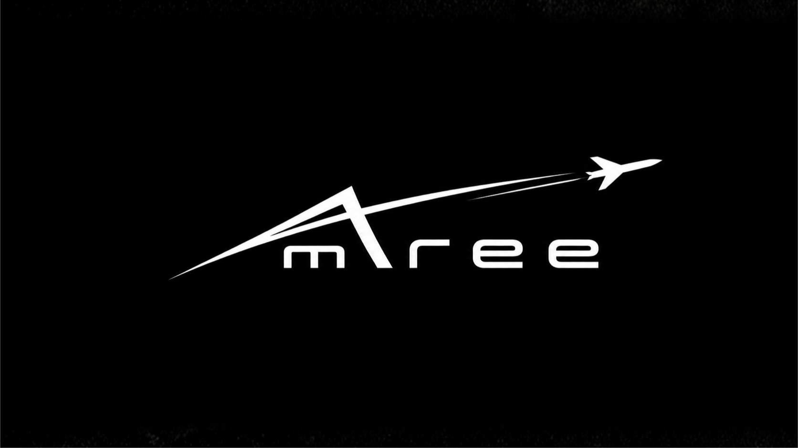
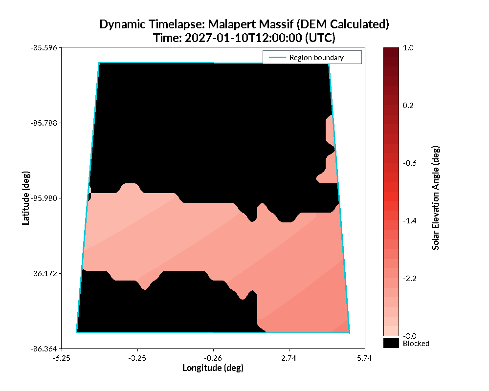
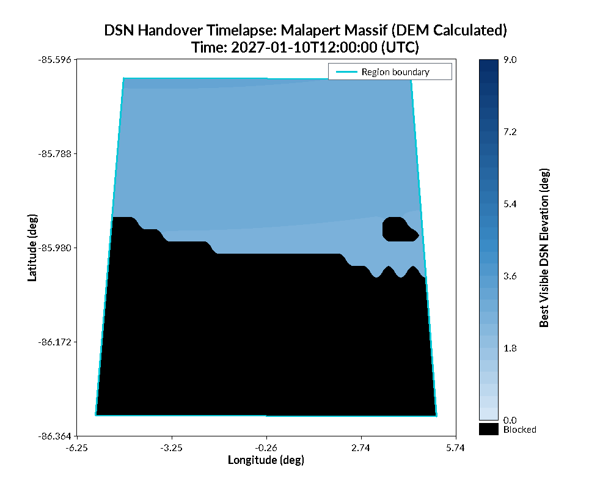

<div align="center">



# A clearer view of the lunar south pole

Explore the Moon. Compare landing locations. Find the light and the connection.

**[Explore AmTree](https://amtree.earth)** · **[How to run it](#run-locally)** · **[Meet the team](#the-team)**

<br />


Built for the **NASA Space Apps Challenge 2026 hackathon in Milan**.

</div>

## The idea

Sunlight and communication matter when choosing where and when to explore the Moon. Near the lunar south pole, the surrounding terrain can hide the Sun or block a view toward Earth, making the timing of a mission just as important as its location.

**AmTree is an interactive lunar planning and visualization project.** It brings terrain, illumination and communications into one experience, helping users compare locations and explore how conditions change over a chosen mission window.

The experience begins with an animated journey from Earth to the Moon, then opens into an interactive globe and a dashboard covering **six study points and nine Artemis III regions**.

## Explore a mission

<table>
  <tr>
    <td width="50%"><strong>Explore the surface</strong><br />Rotate the Moon, examine the south polar relief and open a location to inspect its terrain and visibility.</td>
    <td width="50%"><strong>Choose a time</strong><br />Use Static mode for one UTC instant, or Dynamic mode to sample conditions across a mission window.</td>
  </tr>
  <tr>
    <td><strong>Compare locations</strong><br />Inspect sunlight, Earth visibility, simultaneous coverage and the longest period of darkness.</td>
    <td><strong>Inspect communications</strong><br />Explore modeled visibility toward the Goldstone, Madrid and Canberra Deep Space Network complexes.</td>
  </tr>
  <tr>
    <td><strong>Watch conditions evolve</strong><br />Play through the timeline and inspect illumination and DSN maps alongside the selected location.</td>
    <td><strong>Take the results with you</strong><br />Export telemetry as CSV, comparison charts as PNG, interactive reports as HTML and maps as animated GIFs.</td>
  </tr>
</table>

## Real views from the project

These are the actual bundled map animations used by the site for the Malapert Massif region, rather than mockups or screenshots of the interface. They illustrate the saved baseline from **10 January 2027 at 12:00 UTC to 13 January 2027 at 12:00 UTC**.

<table>
  <tr>
    <th>Solar illumination</th>
    <th>DSN communications</th>
  </tr>
  <tr>
    <td width="50%"></td>
    <td width="50%"></td>
  </tr>
</table>

Red indicates sunlight, blue indicates DSN visibility and black indicates blocked visibility in the respective maps. The terrain backdrop provides context for the changing conditions.

## Science behind the view

AmTree combines **NASA LRO imagery**, **LOLA terrain data** and **SPICE ephemerides**. The custom simulation uses the bundled DE432s ephemeris and lunar orientation kernels to evaluate the Sun, Earth and DSN stations against the local terrain horizon.

The current custom model places an observer two metres above the terrain and evaluates the centres of the Sun and Earth against the modeled horizon. Visibility transitions are interpolated between the selected samples. The supplied kernels support the application's selectable dates from **2 January 1950 to 30 December 2049 UTC**.

This is a hackathon research and visualization prototype, not an operational mission planning tool. DSN results describe geometric visibility, not guaranteed communication service. Antenna availability, link budgets and spacecraft power systems are outside the model. Surface shading is illustrative, and saved presets may use different analysis settings from custom simulations.

## Everything runs in your browser

The current edition performs its scientific calculations on the visitor's device. **No separate Python server or remote calculation API is required.**

<table>
  <tr><td><strong>Interface and globe</strong></td><td>React 19, TypeScript and Three.js</td></tr>
  <tr><td><strong>Scientific runtime</strong></td><td>The original Python algorithms running through Pyodide, with NumPy and Pillow</td></tr>
  <tr><td><strong>Astronomical geometry</strong></td><td>NASA CSPICE compiled to WebAssembly and distributed through SpiceQL</td></tr>
  <tr><td><strong>Build and hosting</strong></td><td>Vite and static hosting, with Netlify configuration included</td></tr>
</table>

Visual assets take priority during startup. When you choose **Plan a landing**, a progress bar occupies the dashboard while the scientific engine and mission data are prepared. The Moon remains interactive during that preparation.

The first preparation downloads approximately **43 MiB** of runtime and scientific data, in addition to the visual assets. Loading time and calculation speed depend on the connection and device. Use a modern browser with WebAssembly, module workers and service workers, over HTTPS or localhost.

## Run locally

Use **Node.js 24** from the project directory.

```sh
npm ci
npm run dev
```

Open the local address printed by Vite. To build and preview the production version:

```sh
npm run build
npm run preview
```

Run the bundled automated checks with:

```sh
npm test
```

The build prepares the runtime files from the included source data. Opening the HTML file directly from the filesystem is not supported. The original Python implementation remains in `Backend` as a reference for validation.

## Publish with Netlify

Connect the GitHub repository and select the `main` branch. Use the repository root, `npm run build` as the build command and `dist` as the publish directory. The included `netlify.toml` already defines these settings.

No external API proxy or Python hosting is needed for this edition. Subsequent pushes to the connected branch can trigger a fresh build and publication.

## Validation and limitations

The browser implementation has been compared with the native Python implementation across multiple dates and mission windows, including a 72 hour analysis from 10 to 13 January 2029. The documented checks cover Chrome, Firefox and WebKit, numerical results, export formats and invalid inputs.

These checks do not guarantee identical behavior on every device or an operational level of scientific accuracy. Small floating point differences and differences in image encoding can occur. Physical mobile devices still require further validation.

The full verification report, implementation details and remaining limitations are recorded in [VERIFICA BROWSER](VERIFICA-BROWSER.md).

## The team

<div align="center">

**Alvise Vivian**<br />
**Daniel Matthew Panganiban**<br />
**Ahmet Orhun Sivaslı**<br />
**Mustapha Bouhka**<br />
**Mohamed Nassiri**

<br />

Created together for NASA Space Apps Challenge 2026 in Milan.

**[Visit amtree.earth](https://amtree.earth)**

</div>
